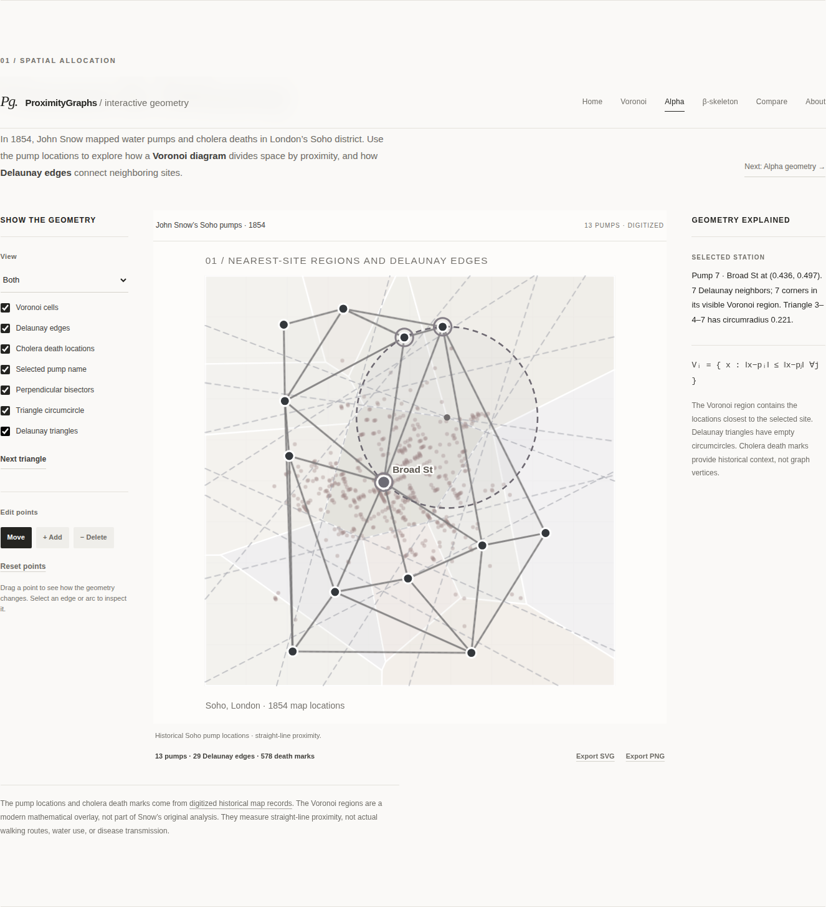
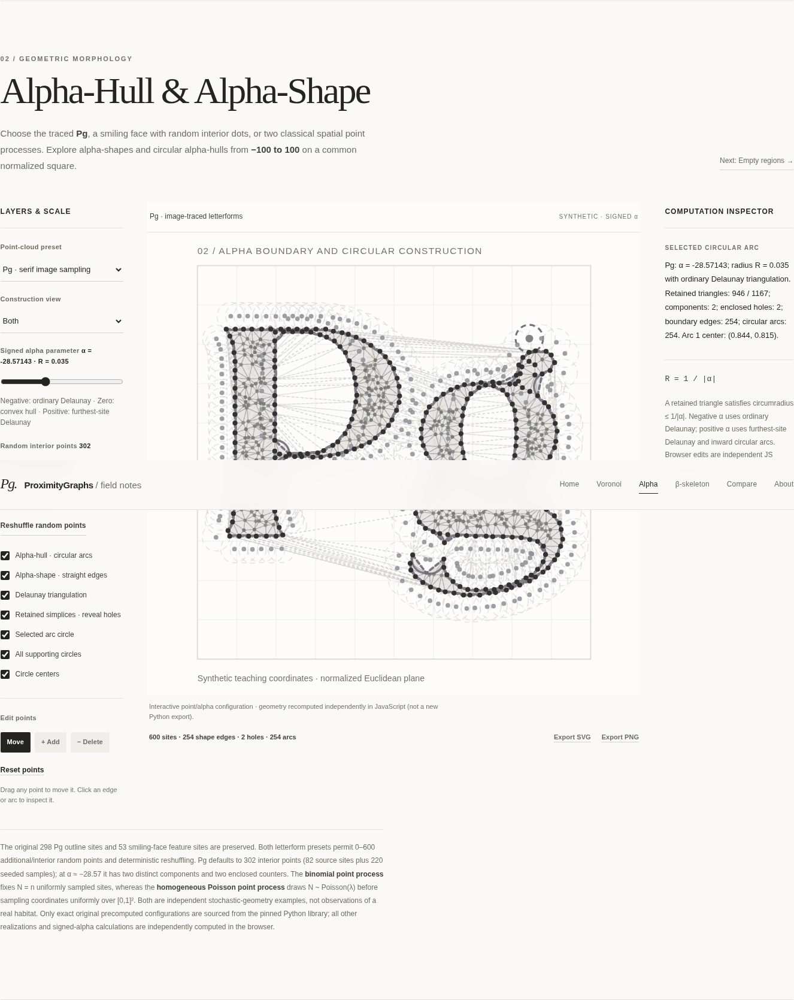
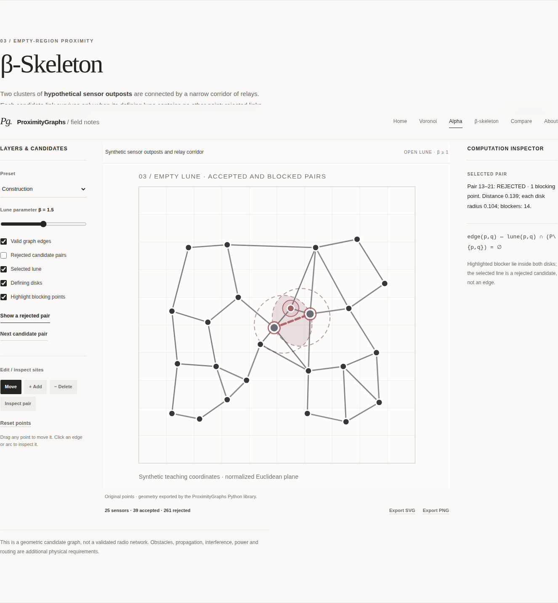

# Who Counts as a Neighbor? — ProximityGraphs for SIAM News

**Status:** working editorial draft, **not** submitted, accepted, peer reviewed, or endorsed by SIAM.

This project develops a proposed **SIAM News — Software and Programming** feature and its reproducible interactive companion. Its subject is the mathematical choice of "neighbor": Voronoi/Delaunay partitions, alpha-shapes and circular alpha-hulls, beta-skeleton empty-region graphs, and controlled graph comparisons.

**[Explore the deployed GitHub Pages companion](https://heri-espino.github.io/proximitygraphs-siam-figures/)** — editable points, interactive geometry and image export. GitHub Actions deployed the site successfully on November 3, 2026; verify the live page after future releases.

**[Read the completed feature draft](article/feature.md)** · **[LaTeX manuscript](article/main.tex)** · **[Outreach and marketing kit](article/marketing-kit.md)** · **[Editorial pitch](article/pitch.md)** · **[Python library](https://github.com/ProximityGraphs/ProximityGraphs)**

## Sectioned mathematical construction laboratory

| Figure | Mathematical objects | Illustrative context | Reader interaction |
| --- | --- | --- | --- |
| 1. Voronoi and Delaunay | Historical pump/death locations, clipped nearest-site cells, bisectors, circumcircles | Digitized 1854 Soho map: 13 pumps and 578 death marks | Toggle historical observations and selected pump name; edit hypothetical pump sites |
| 2. Alpha-shape and alpha-hull | Library `Alpha_Shape` straight boundary, `Alpha_Hull` arcs, retained simplices | A synthetic smiley (30 outline points, two eye rings, 11 mouth points) | Compare straight and curved boundaries and change the negative alpha scale |
| 3. β-skeleton | Empty-lune tests, valid/rejected candidates and blockers | 25 synthetic sensors in two outpost clusters joined by three relay sites | Select candidate pairs, show rejection witnesses, edit positions |
| 4. Compare | Delaunay, Gabriel, RNG, β-skeleton, alpha-shape on shared coordinates | Same synthetic sensors | Compare any two graphs on **identical** sites, swap and count edges |

**The Voronoi sites and death marks are historical map digitizations; the other defaults are synthetic.** The water layer shows 13 John Snow pump sites and 578 individual cholera death marks from HistData/Rdatasets. The Euclidean Voronoi diagram is a modern overlay, not Snow's own method. The alpha scene uses a synthetic smiley, while the beta scene uses two synthetic sensor clusters with relay sites. Neither is empirical habitat or radio coverage data. See [source attribution and normalization](data/historical/README.md).

The site has a guided **Home → Voronoi → Alpha → β-Skeleton → Compare → About** navigation. Existing article anchors `#water`, `#habitat`, and `#sensors` remain valid. Each experiment uses an adjustable layer/control panel, a large SVG plot, and a computation inspector.

Read [**Mathematical construction details and test methodology**](docs/CONSTRUCTIONS.md) for the exact predicates, radii, clipping convention, provenance, and limits.

## Interactive point editing

On **each** visualization, choose **Move** (drag points with mouse or touch), **+ Add** (click an empty location inside the square), **− Delete** (click a point), or **Reset points** (restore the original data). Existing points can also be moved with the arrow keys after keyboard focus; Delete/Enter works in Delete mode.

- Live geometry updates automatically after a point changes.
- Editing is restricted to the normalized unit square, with an 80-point safety limit and a minimum distance between distinct sites to prevent duplicate-point degeneracies.
- Original examples continue using **actual ProximityGraphs-generated data** from the pinned library commit. **Edited point sets are recomputed in the browser using independent JavaScript geometry**, with explicit source labels. Do not describe edited plots as being recalculated by Python ProximityGraphs.
- Export SVG or PNG at any point to save the currently displayed graph, including custom point positions.
- Links to external websites open in a new tab. Internal figure navigation remains on the current page.
- Historical John Snow pump and death coordinates are digitized map observations; edited pumps represent hypothetical scenarios. The smiley and sensor examples remain synthetic and non-validated.

## Repository structure

| Path | Purpose |
| --- | --- |
| \`article/main.tex\` and \`article/feature.md\` | Magazine-style LaTeX proof and matching readable SIAM News feature, with three scientific figures |
| \`article/marketing-kit.md\` | Library positioning, public communication drafts, calls to action and editorial caution notes |
| \`article/output/proximitygraphs-siam-news-draft.pdf\` | Editorial PDF proof generated by the dedicated article workflow, if its build succeeds |
| \`article/pitch.md\` | Editor-facing pitch, not sent |
| \`site/index.html\`, \`styles.css\`, \`app.js\`, \`editor.js\`, \`geometry-details.js\` | Sectioned website, editable points, construction witnesses, graph comparison, SVG/PNG export |
| \`site/data/scenes.json\` | Committed deterministic ProximityGraphs geometry, exported by Python |
| \`site/assets/\` | Six committed static figures (three PNG and three SVG) |
| \`scripts/export_scenes.py\` | **Authoritative** ProximityGraphs-backed data and static-figure builder |
| \`scripts/check_article.py\` | Approximate word-count checker |
| \`tests/test_geometry.py\` and \`tests/test_editor.js\` | Python source geometry tests plus browser recomputation, controls, and external-link regressions |
| \`docs/EDITORIAL.md\`, \`docs/CONSTRUCTIONS.md\` | Editorial provenance and detailed geometric construction rules |
| \`AGENTS.md\`, \`AI_HANDOFF.md\` | Agent-ready rules and continuing handoff |
| \`experiments/\` | Numbered future research/visual design experiments |
| \`.github/workflows/build.yml\` | Installs pinned library, regenerates/commits assets, checks math & JS |
| \`.github/workflows/article-pdf.yml\` | Compiles LaTeX with three PNG figures, checks embedded images, and commits PDF proof |

## Reproduce

Use Python 3.10+ and a network-enabled environment:

\`\`\`bash
python -m venv .venv
source .venv/bin/activate
python -m pip install -r requirements.txt
python scripts/export_scenes.py
python -m unittest discover -s tests -v
python scripts/check_article.py
node --check site/app.js
node --check site/editor.js
node --check site/geometry-details.js
node tests/test_editor.js
\`\`\`

On Windows, activate with \`.venv\\Scripts\\activate\`. The requirements pin the ProximityGraphs source to commit \`d1a216d7255cbebea68dcaad6a97382168a3ec55\`. The workflow also runs these checks on GitHub-hosted Ubuntu, commits authoritative regenerated files to \`main\`, and uploads a CI artifact.

Preview the website locally:

\`\`\`bash
python -m http.server 8000 --directory site
\`\`\`

Visit \`http://localhost:8000/\`. Do not open \`index.html\` directly as a \`file://\` URL because browser security restrictions can block JSON fetches.

The website automatically reads \`site/data/scenes.json\` generated by the Python library for the original point sets, including actual `pg.Alpha_Shape` edges and retained Delaunay triangles. If this file is missing, an independent JavaScript demonstration operates as a clearly labeled **browser preview**. The published version should use the committed authoritative Python data.

## Compile the manuscript

The supplied document is a polished **draft delivery format**, not an official SIAM journal template. SIAM News explicitly says submissions are not research journal papers. The dedicated `article-pdf.yml` workflow compiles with the three committed figure PNGs, checks that figures are embedded, and places the successful proof under `article/output/`. The canonical manuscript prose is also available in `article/feature.md`.

\`\`\`bash
cd article
pdflatex main.tex
pdflatex main.tex
\`\`\`

The generated \`main.pdf\` is a local build artifact (ignored in Git). Exported PNG/SVG scientific figures stay in the repository. For the final editorial version, use the live interface's PNG/SVG export to capture selected interactive states and explicitly label the synthetic point sets.

## GitHub Pages deployment

Pages has been enabled and successfully deployed in a previous workflow. For a fresh repository or after a configuration change, the owner must:

1. Open **Settings → Pages** in this repository and select **Source: GitHub Actions**.
2. Open **Settings → Secrets and variables → Actions → Variables**, add \`DEPLOY_PAGES\` with value \`true\`.
3. Open **Actions → Build reproducible SIAM figures → Run workflow** on \`main\`. The conditional Pages job will deploy the site as a project page.
4. Confirm that \`https://heri-espino.github.io/proximitygraphs-siam-figures/\` actually works. The live URL is *not* verified until this step.
5. Confirm with SIAM News editors that the external interactive links (rather than embedded arbitrary HTML) are acceptable.

**No article has been sent.** Human contributors must approve byline, affiliations, biographies, and final figures first.

## Editorial constraints and sources

The [SIAM News Style Guide](https://www.siam.org/media/gfbjvzck/siam-news-info-and-style-guide.pdf) and [submission guidelines](https://www.siam.org/publications/siam-news/about-siam-news/submission-guidelines/) recommend approximately 800–1,400 words, one to three credited graphics, no more than ten references in APA style, and one- to two-sentence author biographies. Links are supported in web articles and videos may be submitted, but custom interactive embedding is **not** promised.

A useful structural comparator is [*The Dynamics of Debt*](https://www.siam.org/publications/siam-news/articles/the-dynamics-of-debt/), a SIAM News software feature with a mathematical narrative, figures, links, and references.

Consult \`AGENTS.md\`, \`docs/EDITORIAL.md\` and \`AI_HANDOFF.md\` before changing the project.

## Literature-enhanced 2026 SIAM feature

The revised [canonical article](article/feature.md) draws on **61 extracted research papers** from [ProximityGraphs-ML](https://github.com/heri-espino/ProximityGraphs-ML/tree/main/literature/extracted), integrating demonstrated links to manifold learning, geodesic graph statistics, shape/topology reconstruction, β-skeleton street networks, stochastic geometry, and filtered nearest-neighbor retrieval. See the source-by-source [literature evidence audit](docs/LITERATURE_EVIDENCE.md).

**Manuscript source of truth:** edit only \`article/feature.md\`. Run \`python scripts/render_article.py\` to regenerate the complete LaTeX \`article/main.tex\` and use the editorial GitHub Actions workflow to compile and archive its PDF. All ten references, three captions, equations, and coauthor biographies derive from the same Markdown source.

The mathematical theory extends to Euclidean spaces of arbitrary dimension, but the present package's graph constructors are **primarily planar**; do not describe the library as an implemented high-dimensional ANN, manifold-learning, or topological-inference engine.

Proposed authors and affiliations: Héctor Maravillo (Universidad Autónoma Metropolitana, Mexico), Diego Villarreal de la Cerda (T-Systems), Heriberto Espino-Montelongo (Universidad de las Américas Puebla). Final editorial approval is pending.

## Visual proof and browser-level validation

The GitHub Actions [visual QA workflow](https://github.com/heri-espino/proximitygraphs-siam-figures/actions/workflows/visual-qa.yml) uses pinned Playwright and Chromium to inspect the live browser rendering from committed site sources, capture **seven reproducible screenshots**, and archive them under [\`docs/visual-qa/\`](docs/visual-qa/). The [machine-readable visual summary](docs/visual-qa/visual-summary.json) records which tests passed.

| Voronoi construction | Alpha construction | Blocked β-skeleton candidate |
| --- | --- | --- |
|  |  |  |

Recreate the browser screenshots locally (after installing Playwright 1.57.0 and Chromium) with:

\`\`\`bash
python tests/visual_smoke.py --output docs/visual-qa
\`\`\`

The visual QA job also tests touch-sized/mobile layout, individual sensor-pair inspection, dragging, and graph comparisons. Automated screenshots are reproducible figures and remain committed; they are **not** measurements of performance or validated deployment case studies.
